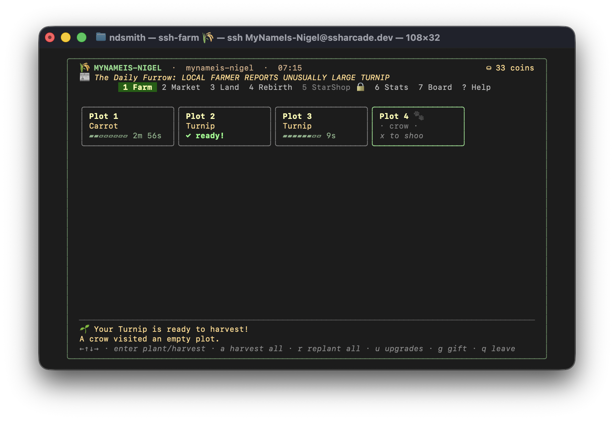
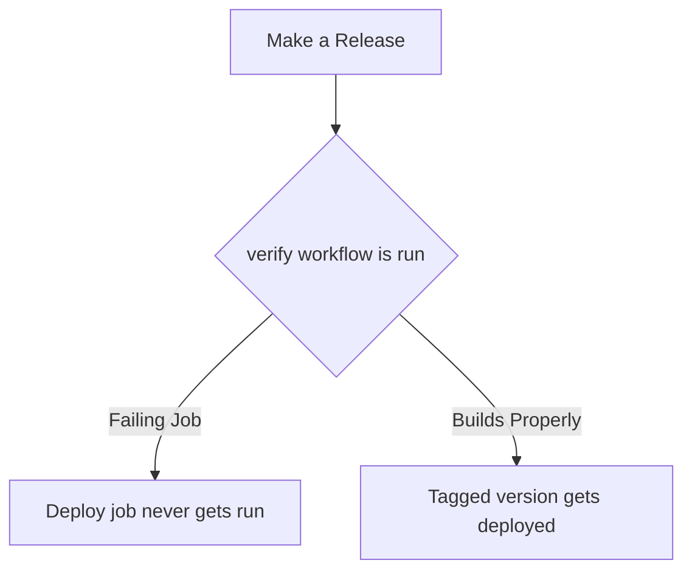

# Nigel Smith

**Security & Infrastructure Engineer**

Currently pursuing a B.S. in Cybersecurity at BYU-Idaho (Est. 2027) while working in the field.

> [!TIP]
> I'm from Monroe, GA; Currently in Rexburg, ID

## Experience

**Fybercom (Security & Infrastructure Engineer)** — Auditing & security infrastructure, implementing security patches, 

**Fybercom (Technical Support)** — Configured Ubiquiti, Cambium, and Tarana radio/fiber equipment; managed customer networks via CRM & troubleshot through 200+ calls a month

**Roundsphere (DevOps Intern)** — Migrated production apps to IaC with AWS CloudFormation; cut cloud spend by 14% through RDS consolidation; oversaw Google Workspace migrations

**Full Coverage Tech (Cloud & IT Consultant)** — Sole technical contact for managed IT client; M365 admin, Exchange triage, endpoint management, and on-prem network deployments

---

## Certifications

| Credential | Status |
|---|---|
| ISC² Certified in Cybersecurity (CC) | Earned |
| CompTIA A+ | Earned |
| AWS Cloud Practitioner | Earned |
| CompTIA Security+ | Earned |
| TCM PSAA | In-Progress |
| Cisco CCNA | In-Progress |
| AWS Solutions Architect | In-Progress |

## Contact Info

[nigel.nds.smith@gmail.com](mailto:nigel.nds.smith@gmail.com) · [LinkedIn](https://linkedin.com/in/nigeld-smith) · [Portfolio](https://nigel-smith.dev)

---

# Projects

An overview of some of my **personal work** that I can share. These are what I am most proud of. 

## SSH-Farm (ssharcade.dev)

> [!NOTE] 
> This screenshot may not accurately reflect the current state of the game. This is an active project. 

SSH Idlefarmer, a terminal user interface (TUI) game that you can SSH into right now! Try `ssh ssharcade.dev` (from the menu, hit IDLE FARMER).

The arcade runs on a single AWS EC2 t3.micro instance running 4 docker instances for each game. DNS is handled through Cloudflare, the reverse proxy is run on Caddy, each game is written in Go and packed into a Docker image.

**ssh-farm Release flowchart**

> *See more details at [ssh-farm](https://github.com/MyNameIs-Nigel/ssh-farm)*
